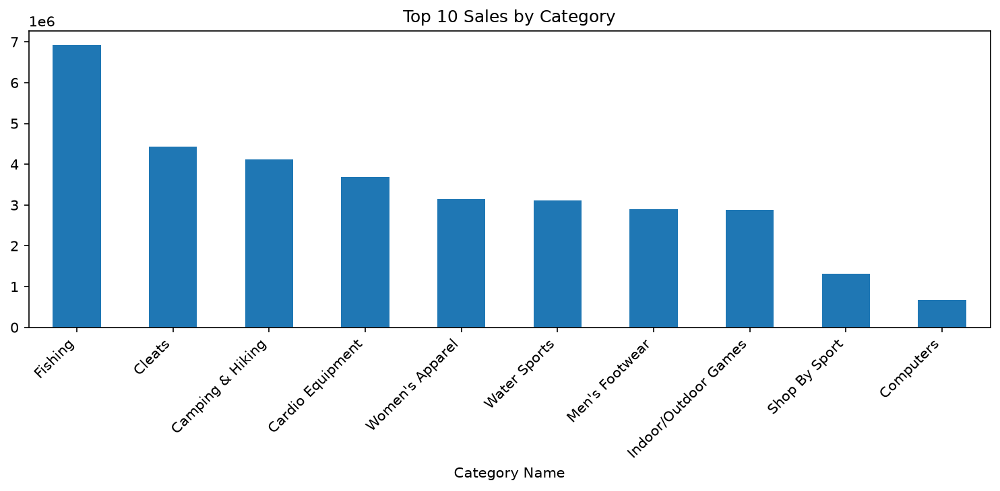

# Supply Prescript

## Overview
Supply Prescript is a supply chain analytics project focused on exploring order, shipping, product, and customer data to understand operational performance and identify patterns in delivery and fulfillment processes.

## Objective
The goal of this project is to inspect the dataset, clean and preprocess the data, analyze the key variables, and prepare the project for deeper business analysis and predictive modeling.

## Dataset
This project uses the DataCo Supply Chain Dataset stored in the `data/archive` folder.

The dataset includes information related to:
- orders and order status
- shipping modes and delivery timelines
- product categories and product attributes
- customer and regional information
- sales, profit, and order metrics

## Current Status
- Dataset has been loaded and inspected successfully
- Column types and schema have been reviewed
- Exact duplicate rows were checked
- A cleaning script removes unusable and direct-identification columns, trims text, validates dates, and saves an analysis-ready dataset
- Exploratory analysis reports category sales and profit, shipping modes, delivery status, and late-delivery rate

## Setup
Install the required Python libraries:

```bash
python -m pip install pandas numpy matplotlib seaborn
```

## Run the dataset inspection

```bash
python data/check_dataset.py
```

## Clean the dataset

```bash
python data/clean_data.py
```

The cleaning script keeps the raw files in `data/archive` unchanged and writes the cleaned analysis dataset to `data/processed/cleaned_supply_chain.csv`. The generated CSV is excluded from Git because it is a large derived file. A small `cleaning_report.json` records row counts, removed columns, date conversions, and cleaning checks.

## Exploratory Analysis

Run the analysis from the project root after cleaning the dataset:

```bash
python eda_analysis.py
```

The script prints summary tables and saves a sales-by-category chart as `eda_summary.png`.



## Project Structure

```text
SupplyPrescript/
├── data/
│   ├── archive/
│   │   ├── DataCoSupplyChainDataset.csv
│   │   ├── DescriptionDataCoSupplyChain.csv
│   │   └── tokenized_access_logs.csv
│   └── check_dataset.py
│   ├── clean_data.py
│   └── processed/ (generated by clean_data.py)
├── .gitignore
├── README.md
└── .git/
```

## Workflow
1. Load and inspect the dataset
2. Clean missing values and duplicates
3. Convert and validate datatypes
4. Explore key trends and relationships
5. Perform feature engineering and analysis
6. Build predictive or decision-support models as needed

## Notes
This project is intended for exploratory analysis and may be extended with feature engineering, business insights, and predictive modeling based on the supply chain data.

